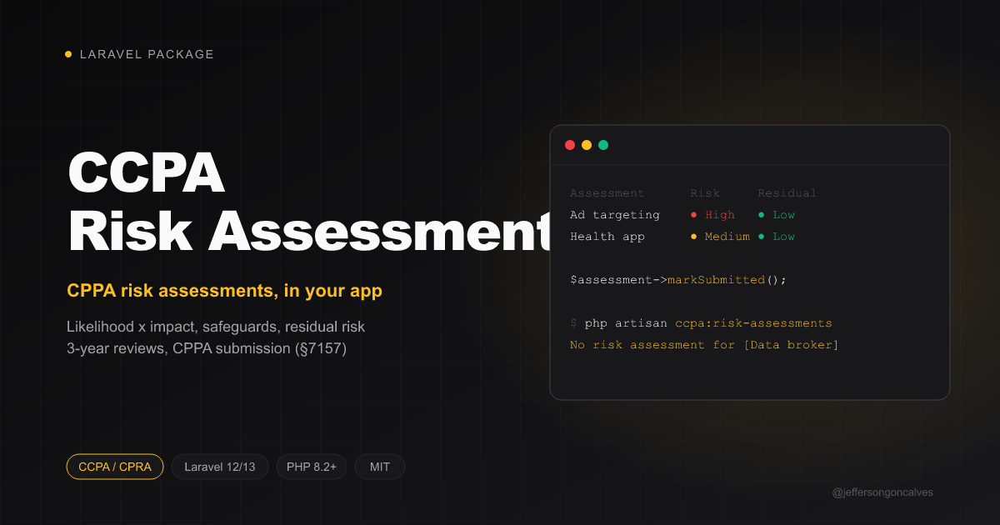

# Laravel CCPA Risk Assessments



[](https://packagist.org/packages/jeffersongoncalves/laravel-ccpa-risk-assessments)
[](https://github.com/jeffersongoncalves/laravel-ccpa-risk-assessments/actions/workflows/tests.yml)
[](https://packagist.org/packages/jeffersongoncalves/laravel-ccpa-risk-assessments)

Risk assessments under the California Consumer Privacy Act regulations (CCPA Regulations, Article 10, §§7150 to 7157). It is part of the [laravel-ccpa](https://github.com/jeffersongoncalves/laravel-ccpa) suite. Each assessment can be linked to a processing activity from [laravel-ccpa-notices](https://github.com/jeffersongoncalves/laravel-ccpa-notices).

- **Describe the processing:** what it does, the information it uses, and why it is necessary.
- **Score the risks:** each risk gets a likelihood and an impact from 1 to 3, before and after the safeguards. A [LINDDUN](https://linddun.org) threat category is optional.
- **Review and approve:** record who reviewed it and their views, then approve. The next review is scheduled for 3 years later (§7155). Editing an approved assessment sends it back to draft.
- **Submission:** record when you submitted the assessment information to the California Privacy Protection Agency (§7157).
- **Find the gaps:** see which processing activities sell or share personal information, or process sensitive personal information, and have no assessment yet. Both present a significant risk (§7150(b)).

> This package gives you tooling. It does not make you compliant on its own. Your assessments need legal review.

## Installation

```bash
composer require jeffersongoncalves/laravel-ccpa-risk-assessments
php artisan vendor:publish --tag="ccpa-notices-migrations"            # if not published yet
php artisan vendor:publish --tag="ccpa-risk-assessments-migrations"
php artisan migrate
```

## Usage

```php
use JeffersonGoncalves\CcpaRiskAssessments\Models\RiskAssessment;

$assessment = RiskAssessment::create([
    'title' => 'Cross-context behavioral advertising',
    'processing_activity_id' => $adTargeting->id,
    'description' => 'We share browsing data with an ad network to show targeted ads.',
    'necessity' => 'Only page categories, no precise location.',
    'risks' => [
        [
            'title' => 'Profiling beyond consumer expectations',
            'threat' => 'linking',
            'likelihood' => 3, 'impact' => 2,                     // high
            'measures' => 'Honor GPC, 13-month retention, contract with the ad network',
            'residual_likelihood' => 1, 'residual_impact' => 2,   // low
        ],
    ],
    'reviewer_opinion' => 'Acceptable with the listed safeguards.',
]);

$assessment->scoredRisks();        // each risk with its level and residual_level
$assessment->highestRisk();        // RiskLevel::Low (residual)
$assessment->approve('Privacy lead');
$assessment->markSubmitted();      // submitted to the CPPA
$assessment->isReviewDue();
RiskAssessment::query()->scopes('dueForReview')->get();
```

A risk's level is likelihood × impact: 1–2 is low, 3–4 is medium and 6–9 is high.

### Which activities need one

```php
use JeffersonGoncalves\CcpaRiskAssessments\Facades\CcpaRiskAssessments;

CcpaRiskAssessments::candidates();
// [['activity' => ProcessingActivity, 'reasons' => ['selling_sharing', 'sensitive_pi']], ...]
```

Automated decision-making for significant decisions, and profiling of workers or students, are also significant-risk processing (§7150(b)). Judge those yourself.

## Report

```bash
php artisan ccpa:risk-assessments          # assessments with their risks and next review, then the gaps
php artisan ccpa:risk-assessments --json
```

## Testing

```bash
composer test
```

## Changelog

See [CHANGELOG](CHANGELOG.md).

## License

The MIT License (MIT). See [License File](LICENSE.md).
